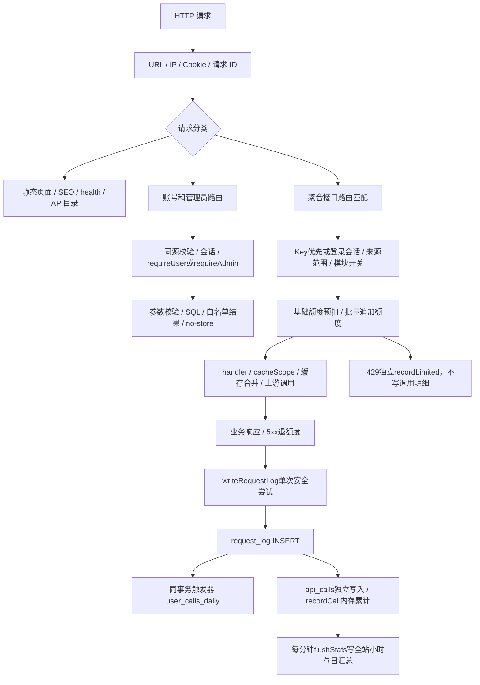

# API 流程与结构审查

## 范围与版本

- 审查对象：`bocmiao/api`，本地分支 `Miao-API`；产品源码绑定 **`a1ba2614de424835bab2a05b808a33b9a21de648`**。
- 开始时 HEAD 等于上述 SHA，`git status --porcelain` 为空。该版本已有 1130 项全套和浏览器验收证据；本次不重复全套，不把静态审查当成新的完整验收。
- 本次仅阅读源码、在独立 `DB_FILE=:memory:` 进程做四个小型合成复现、保存本报告。未读取真实数据库/密钥，未调用真实外部服务，未安装依赖或修改产品代码。
- `/workspace` 只发现 `api/package.json` 与 `api/.git`。根目录 `.git` 是不可用的挂载占位，`git -C /workspace status` 返回 “not a git repository”；`library-files`、`scratch`、`shared` 未发现其他项目源码。其他项目名称/路径尚待明确，不能声称已审查。
- 没有推送、PR、CI、GitHub 设置或环境发布操作。此前的配置草稿不变；本报告与源码恢复 bundle 是独立交付物。

## 实际业务与数据流

### 请求、身份与额度

`src/app.js:handle` 分发顺序为 OPTIONS、网页/SEO/静态特例、health/目录、账号路由、聚合路由。`src/registry.js` 从模块声明创建路由与目录，接口函数负责业务参数和数据源；`invoke`、巡检与自动健康检测可以直接执行 handler，刻意绕过对外额度及调用日志。

聚合路由先匹配 method/path，再解析 Key：Bearer 优先于 X-API-Key、查询 key；有 Key 就不回退到会话。`auth.userFromApiKey` 将 Key 与用户 JOIN，确认用户未停用，更新 Key 使用时间；入口进一步检查 Key 停用、来源、模块范围。无 Key 时使用会话。已识别 Key 的 403 可以归属用户；无效 Key、匿名、公开路由等沿用已验收统计口径，不按 IP 猜用户。

`limits.consume` 按 user 或匿名 IP 分配 subject，按北京时间扣 `usage_daily` 或兑换码 `bonus_calls`，分钟窗口在内存中。入口先扣一次；批量 handler 经 `ctx.charge(n)` 追加，`src/apis/net/batch.js:charge` 传入目标数减一。charge 明细保存扣款日期和来源；`refund` 用原始明细退回，5xx 不退分钟频率。**额度归属扣款日，调用汇总归属完成写日志日，跨午夜请求两者可以不同；HTTP 调用次数和批量额度也不是同一指标。**

### 缓存与上游

`cache.TTLCache` 管理最多 5000 条内存数据，同 key 的 `pending` 合并 loader；新鲜数据直接返回，刚过期数据先返回并后台刷新，其他请求同步等待；loader 失败且有旧条目时返回 stale。`AsyncLocalStorage cacheScope` 传递管理员 TTL 覆盖并收集缓存 key，避免各 handler 重复读取后台配置。

`http.request` 经 `proxy.outboundFetch` 发请求，用自身 timeout signal，转译网络异常；`fetchJSON/fetchText` 解析内容。网络检测模块还使用 `net/common` 的限时/限大小/SSRF 保护，不能因为存在多个 fetch 包装就直接合并掉安全边界。

### 持久化与管理员展示

`limits.logRequest` 写原始日志；SQLite `user_calls_log_insert` 同一 INSERT 事务累计 `(user_id,day,path)`。之后 `api_calls` 单独执行，再将全站详细统计加到内存；**只有原日志与用户日汇总属于已保证的原子范围，不能声称所有统计一起原子提交。**

`writeRequestLog` 在 HTTP 边界隔离日志错误：只尝试一次，打印故障，不二次记假 500、不让日志异常误退成功请求额度；失败时两张原子表都没有该记录，这是可用性与记录完整性的明确取舍，当前没有持久补写队列。未来应给故障可观察性，不能取消隔离恢复旧问题。

`user_id_sequence` 从用户、保留日志、永久日汇总的最大身份初始化持久高水位，users INSERT 触发器维护它；注册用单条 `INSERT SELECT last_id+1` 原子分配。注销不降低值，防止新用户继承旧记录。未来抽用户仓储时必须保留这一契约，不能退回 SQLite 的普通自动 rowid 分配。此前已删除且无任何保留证据的历史身份无法重建。

`account.js` 的详情路由先 `requireAdmin`，后验真实日期/安全用户 ID，参数化查询，无 Top N 限制，返回白名单字段；管理员 API 使用 no-store。`public/app.js:userCallDetails` 复用 modal/esc，通过弹窗局部 seq 与 root.isConnected 拒绝旧日期、旧用户或关闭后的回写。它绕过页面缓存，以保证日期详情直接取新数据。用户列表分页按钮选择器限定在 `#users-page` 的 `button[data-page]`，不会修改其他列表处理器。

### 启动、迁移、保留与恢复

| 状态 | 所属模块 / 生命周期 | 当前保证与限制 |
|---|---|---|
| SQLite / schema | `db.js` 导入时建表和迁移 | 新用户汇总使用 BEGIN IMMEDIATE、回填、标记、触发器一起提交；旧迁移不都具有同等事务保障 |
| 调用原日志 | `limits.pruneLogs`，默认30天 | 清理不影响用户永久日汇总；已删明细无法恢复 |
| 用户日汇总 / 身份高水位 | `user_calls_daily/user_id_sequence`，永久 | Key 重置/删除不丢历史；注销后 ID 不复用 |
| 全站小时/日统计 | `stats.js` | 小时默认90天、日永久；内存批次每60秒提交，异常终止可能丢尚未刷盘部分 |
| 429 明细 / 每日基础额度 | `stats_limited/usage_daily` | 前者按原日志保留期清理；后者按 cutoff 的北京时间日清理 |
| 会话 | `auth.js`、`pruneLogs` | 过期/注销失效；敏感数据由数据库保存，不回显于详情 |
| cache、分钟窗口、巡检/抓取进度 | 进程内 | 重启后丢失，不是可恢复业务账本 |
| 启动与维护 | `server.js` | 首次 prune，启动统计/推送/预热/健康任务；6小时再次清理，退出同步 flush |
| 在线更新 | `updater.js/swap.js/launcher.js` | 管理员触发；staging校验、备份替换、pending标记、重启；新进程20秒内失败可回滚代码，不能据此推断业务数据回滚 |

用户汇总标记中的 started_at 决定 completeFrom=下一北京时间自然日。首次安装当天及更早一律保守 partial；该日即使没有丢失日志，也不声称完整。未来日期空记录仅表示目前没有调用，不等于已完成该日统计。

## 异常、取消、恢复边界

- 业务异常：`HttpError` 映射 HTTP/errorCode；5xx退额度；429单列计数。日志错误不改变已完成业务结果。
- HTTP 基础解析：URL、IP、Cookie 当前位于业务 try 之前，存在逃出该错误边界的情况，见建议3。
- 浏览器详情关闭：阻止 DOM 回写，不会取消已发 fetch；页面缓存的后台刷新失败被忽略，冷加载错误由页面/路由显示。
- 客户端断连：入口没有统一 req-aborted/res-close → handler signal 的传播链；上游仍按自身超时结束。是否该取消写操作/共享 loader 必须逐类定约，不能无条件中断。
- 巡检停止：`inspect.stopInspect` 只停止后续目标，正在执行的调用仍结束或超时；`withTimeout` 的 Promise.race 不停止原 Promise。这是协作式停止，不是强制取消。
- 程序恢复：持久 SQLite/WAL、迁移标记、高水位与更新 pending 可重读；内存缓存、分钟窗口与统计待刷批次不靠环境快照恢复。源码 bundle 是源码备份，不是运行数据库备份。

## 最值得做的五项改动（本次均未实施）

### 1. P1：保证全站统计失败可重试，明确统计账本与迁移边界

**事实与证据：** `stats.js:flushStats`（131行）先复制并清空 pending/pendingLimited，再 BEGIN/写 SQL；失败 ROLLBACK 后不还原批次。纯内存注入 stats_daily 插入失败，确认小时写回滚、pending变0；移除故障再 flush仍无记录。`limits.logRequest`（104行）依次执行原日志/用户汇总、api_calls、内存统计，后两步不在前一步事务内。`db.js` 的旧 api_calls/newStats 回填（118/136/150行）以表是否存在判断，没有新迁移的完整事务+版本标记。**性能风险推测：** 首次大日志回填和同步刷盘可能阻塞事件循环，尚未做容量/延迟测量。

**最小迁移：** 先只把待写批次从“清空后尝试”改成“提交成功后移除”；失败保留重试，防止重复加总。将北京时间工具迁到无副作用的小模块，解除 limits ↔ stats 的循环依赖。为后续 schema 增加版本化事务入口，先迁移新汇总和新升级，不重跑旧回填或假定能恢复已丢数据；原日志/用户汇总触发器继续保留。明确 api_calls、全站统计与日汇总各自的完整性等级，先记录失败计数，不立即做庞大事件平台。

**收益/成本/风险：** 防止一次刷盘失败形成永久少计；成本小到中。风险是重试重复计数、失败批次无限增长与旧迁移重放，需要有界队列/故障指标；修正失败重试不能解决 SIGKILL 前未落盘，要求强耐久时再评估持久 outbox。

**验证：** 故障注入每个写阶段，失败→恢复→重复flush，确认所有维度恰好一次；新旧数据库重启、迁移事务中断及 prune 后保留；以合成日志量测首次启动与flush耗时，不能直接对真实用户库做压测。

### 2. P1：将批量请求额度改为请求级预留/结算

**事实与证据：** `app.js:handle` 先 `consume(...,1)`，handler的ctx.charge追加；`limits.consume`（37行）拒绝追加量时抛429，HTTP catch仅为>=500调用refund。合成用户日限额2：先扣1、再追加2被429拒绝，usage_daily仍为1。每笔 consume 是全扣或拒绝，**整个批量 HTTP 请求不是全扣或拒绝**；这与 limits 注释的请求整体口径有偏差。

**最小迁移：** 给已存在 charges 增加“已开始业务工作/已预留”的状态，批量 handler在开展外部操作前校验目标总成本，一次预留总量；过渡时仅对明确“追加额度拒绝且尚未执行工作”的路径回退已有预留，保留普通4xx和已执行工作现有收费规则。拒绝的频率窗口不退；不能简单对所有429无条件退款。

**收益/成本/风险：** 避免拒绝的批量调用部分扣费，成本中；风险是改变普通4xx计费、兑换码退款或给已开展工作的请求退费。只支持现有单实例，不顺势引入分布式限流。

**验证：** 总量不足、bonus组合、分钟/模块429、开始执行后的业务错误、5xx、跨日退款、同一请求重复结算；使用假handler验证外部动作未发生。随后跑受影响的 platform/netbatch/user-calls 测试再做一次最终全套。

### 3. P1：把 HTTP 基础解析纳入异常边界，再提取轻量执行阶段

**事实与证据：** `app.js:handle` 在进入try前执行 `new URL` 与 `auth.parseCookies`；后者直接decodeURIComponent。合成 `GET /health`、Cookie `sid=%`，确认 handle直接拒绝为URIError，而非返回受控错误。`server.js` 直接createServer(handle)，没有捕获其Promise拒绝；默认Node未处理拒绝可导致进程退出是运行风险推断，本次未刻意杀服务验证。

**最小迁移：** 先把不可信请求解析放入同一异常边界，为畸形Cookie/URL定义400或忽略无效Cookie的明确策略。随后按“解析→身份与访问策略→计费与执行→响应→安全观测”提取普通ESM函数，保持顺序和原403/429/public口径。把logRequest从limits职责移到观测模块，但writeRequestLog继续留在HTTP边界且仅尝试一次；不要重写全部路由。

**收益/成本/风险：** 避免一条畸形请求逃出入口；减少计费和日志异常互相污染，成本小到中。风险是把无效Key误回退为会话、改变Key权限检查顺序、把内部invoke也计费。

**验证：** 畸形URL/Cookie、body413、错误method、登录/Key所有分支、权限403、OPTIONS、public/匿名/内部invoke、业务与日志双故障；验证进程继续处理下一条请求，不仅断言错误码。

### 4. P2：统一前端请求归属和页面销毁规则，按功能小步拆文件

**事实与证据：** `public/app.js:userCallDetails`（1673行）已有局部seq/isConnected隔离，应保留。`pageAdminUsers`（1600行）没有同类序号，搜索/分页直接并行await后写body；`router`（2261行）增加navToken，但冷加载后switch/catch没有检查该token，可能将旧页面错误写进新main。这是源码证据支持的乱序风险，本次未新跑浏览器制造该场景。`cachedGet`（75行）把fetch、缓存与router刷新耦合；整个app文件2351行，不能仅因长度认定必须换框架。

**最小迁移：** 从用户列表与详情开始引入轻量“请求代号+owner是否存活”的辅助函数；每个await后的DOM写入与catch都验证归属。api可选接收AbortSignal，销毁时取消独享读请求，忽略AbortError。把用户列表/详情抽成独立原生脚本或ESM功能模块，沿用modal/esc和样式，再渐进拆管理员页；不要首先迁移整站路由或增加状态管理框架。

**收益/成本/风险：** 避免搜索分页回退、跨页面错误覆盖，明确状态所有权；成本中。风险是缓存后台刷新被不当取消、全局事件监听重复、旧页面仍持有句柄。

**验证：** 定向浏览器延迟/故障注入：两次搜索、分页与size交错、切页后旧失败、关闭/重开不同用户与日期；同时保留25用户分页和23接口已有用例。不必重跑与前端无关的外部接口实测。

### 5. P2：为缓存旧值、清除和取消建立显式策略

**事实与证据：** `cache.js:wrap/get` 的MAX_STALE_MS只限制SWR窗口，loader失败时任何仍保留的hit都能回退；合成30天过期条目确认仍返回stale。没有证据能断定每类接口允许的旧数据时长，所以“应统一禁掉所有旧值”是未经产品口径支持的结论。`clearModuleCache`只删除store和routeKeys，不失效pending loader，正在执行的loader完成后可以再写入；这是静态路径可推导的行为，本次未另作复现。`http.request`只接自身timeout，`inspect.withTimeout/stopInspect`不真正中断正在执行的handler。

**最小迁移：** 给每类数据源声明允许的最大回退年龄，默认先保持兼容，逐类确认后收紧；保留updatedAt/stale提示。清缓存使用key/module generation，旧generation loader不得回填。增加可选调用signal及任务generation，明确“停止排队”与“中断在途”的差异。共享pending loader不绑定单个客户端的取消；一个客户端退出不能使其他等待者失败。

**收益/成本/风险：** 防止长期旧值与清除后的反向回填，减少巡检超时后持续工作；成本中。风险是失去上游故障兜底、共享缓存被取消、第三方副作用中断后无法判定结果。

**验证：** 纯假时钟/假loader覆盖新鲜、SWR、超龄回退、共享并发、清除后在途完成、一个订阅者取消、巡检停止与超时；再测公开响应的cached/stale/updatedAt语义。是否可取消写操作需要单独业务约定。

## 应保留的结构与实施顺序

保留Node22.13+内置SQLite、零依赖ESM、原生前端；保留registry的模块声明驱动目录/路由、handler业务边界、统一HttpError、安全网络检测包装、参数化SQL、管理员白名单与no-store。保留WAL、request_log与user_calls_daily触发器原子性、新迁移事务标记、身份高水位、首次安装日保守partial、独立429指标、分钟频率与额度分离、共享loader合并。无需先换数据库、框架、ORM、事件总线或拆服务。

建议先做可复现且影响可靠性/额度/入口存活的1—3，再做前端归属4与缓存/取消5。任何结构提取都先固化原有口径，不顺便修改保留期、计费、Key权限或用户身份策略。同步SQLite、历史查询增长及后台任务重叠有容量风险，但本次没有生产规模数据或压测，不能给出虚假的延迟/吞吐收益。

## 工作流与交付边界

现有 `.github/workflows/ci.yml` 对所有push和pull_request执行Node22 `node --test`，没有部署步骤；README后台在线更新由管理员发起，launcher仅执行重启/回滚。仓库文件无法排除外部webhook/托管自动部署。此前有关改手动工作流或push的确认没有得到明确批准，本次“也看一下”不增加这些操作权限。

本报告为下一轮选择改动的输入，不表示上述建议已实现。原先交付bundle仍绑定a1ba261产品源码；如本报告单独本地提交，新增提交只含文档，产品行为与此前验收版不变，不能把文档提交冒充新的全套测试结果。
