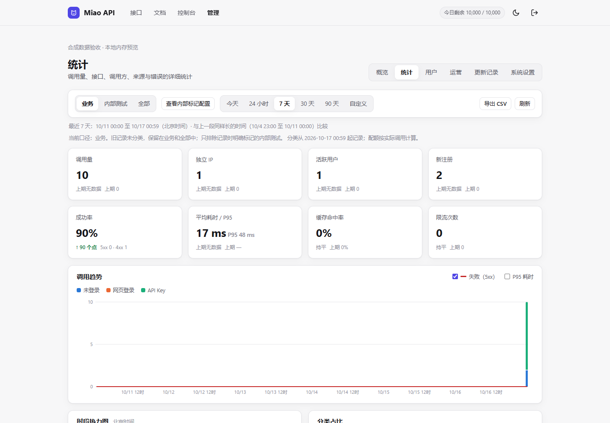
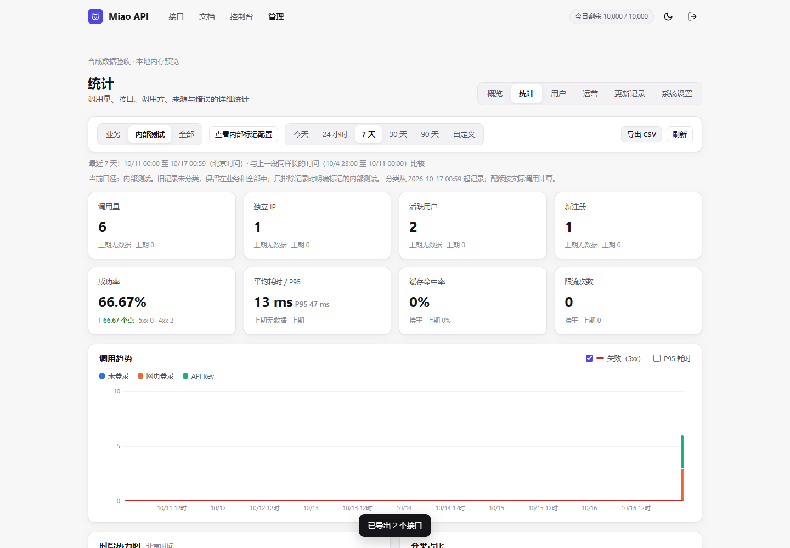
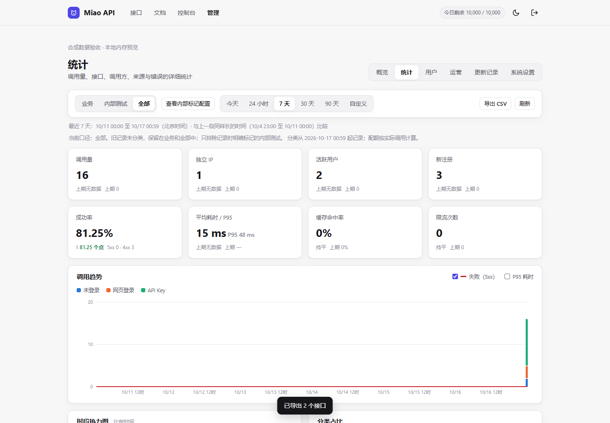
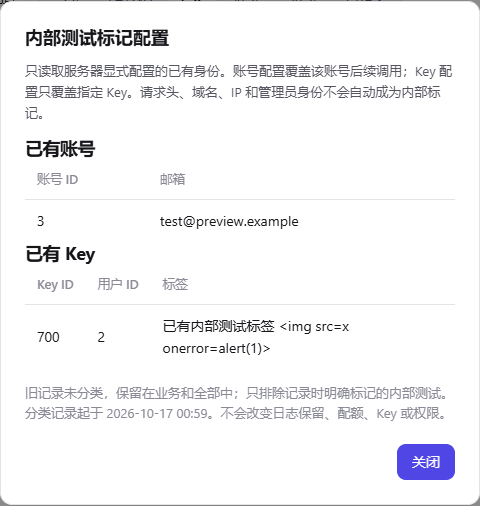
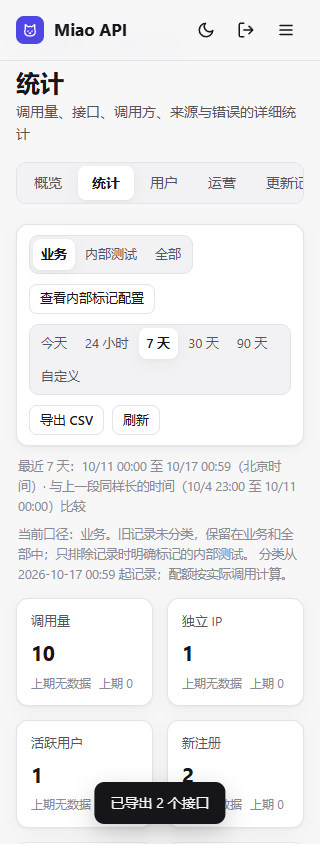

# 内部测试隔离验收记录

2026-10-16 UTC，独立工作区 `D:\codex存储\2026-10-15\task-4\api`。开始时本地为 `2f0ded7d62e6c5ec923055812d0a7a041924d7f7`；执行 `git fetch origin Miao-API`、`git merge --ff-only origin/Miao-API` 后，基线更新为 `d5db3e92302ee88bc88d9a3350bcd3ac77d72bdf`。保留该基线已有的更新身份核验和进程验证改动。未发现仓库 AGENTS/CONTEXT 指引，现有 Actions 仅 `workflow_dispatch`，无 CNB 配置。

## 实际验证

| 命令 / 检查 | 结果 |
| --- | --- |
| `node --version` | `v24.19.0`；项目最低要求仍为 Node 22.13 |
| `node --test test/analytics.test.js test/source.test.js test/site.test.js test/user-calls.test.js` | 38通过、0失败、0跳过 |
| `node --test test/traffic.test.js` | 最终8通过、0失败、0跳过；首轮夹具的 Key 格式及必填 IP 错误已修正，没有放宽认证或运行时代码以迁就夹具 |
| `node --test test/traffic.test.js test/analytics.test.js test/site.test.js test/user-calls.test.js` | 最后关联回归39通过、0失败、0跳过 |
| `node --test test/update-lifecycle.test.js test/update-process.test.js test/deployment.test.js` | 20通过、0失败、1跳过，包含真实本地 launcher/server 重启、20秒观察和崩溃回滚 |
| `node --test` | **1212项：1211通过、0失败、1跳过**，112 suites；原始输出保存在忽略目录 `data/traffic-final-tests.txt` |
| `node --check public/admin-stats.js`、`git diff --check` | 通过 |
| `node scripts/check-traffic-ui.js` | 真实 Chromium **153.0.8010.12**；10组检查通过，页面 JavaScript errors为0 |

本地 HTTP、子进程与浏览器测试通过正常执行审批运行。没有修改生产环境文件、权限、真实账号、Key 或凭证，没有部署或对线上 API 发出测试请求。固定 Key 字符串及会话仅存在于本地合成夹具/内存数据库中，不生成真实 API Key。

全套首轮还暴露了基线在 Windows 的文件路径问题：更新校验将盘符路径直接用于 ESM import，进程测试 preload 也直接使用盘符路径。已改为标准 `pathToFileURL(...).href`；临时 Git 夹具显式关闭 autocrlf，保证下载包与源码字节一致。没有改变更新权限、官方核验、重启观察或回滚策略。

唯一跳过项是「符号链接不能冒认部署身份」：实际创建符号链接返回 Windows `EPERM`。该用例单独列出并明确跳过，未更改系统权限；同一文件中逐文件 Git 身份核验、手动覆盖、额外文件及其余全部用例均已执行通过。日志中的一次 `stats_write_failed` 来自主动注入事务故障的测试，回滚和重试断言通过。

## 功能证据

- 服务器显式配置已有账号/单个 Key，空配置不自动选择管理员；同用户的其他 Key、网页登录、匿名、伪造头和 localhost/IP 不会被推断为内部。
- 在认证阶段保存分类快照，保留逐请求分类与依据；已变更/重用 Key 不静默继承内部绑定，配置接口不返回 Key hash、指纹或凭证。
- 业务默认排除明确内部调用，全部与业务+内部的调用数对齐；来源、错误、限流、按用户日统计和公开业务数字均覆盖，实际配额不被统计过滤影响。
- 旧日志、日汇总和来源按未分类历史保留，重复升级不重计；失败迁移、写入/flush故障均回滚后可重试，原始日志清理后分类日汇总继续保留。
- 18个并发请求检查作用域和实际数量均一致，不依赖共享可变全局口径。

浏览器使用已安装 Playwright，实际设置：

```powershell
$env:PLAYWRIGHT_MODULE='file:///C:/Users/10743/.cache/codex-runtimes/codex-primary-runtime/dependencies/node/node_modules/playwright/index.mjs'
$env:CHROMIUM_PATH='C:\Users\10743\AppData\Local\ms-playwright\chromium-1243\chrome-win64\chrome.exe'
node scripts/check-traffic-ui.js
```

合成数据为业务10次（含2次未分类历史）、内部6次、全部16次。验证口径切换、CSV 文件名/列/行、日志明细、配置只读与恶意标签转义、错误重试、390px/320px无页面溢出、键盘操作、重新进入默认业务及401/403。

[机器可读浏览器结果](traffic-validation/browser-results.json)

| 默认业务 | 内部测试 |
| --- | --- |
|  |  |

| 全部 | 只读配置 |
| --- | --- |
|  |  |



## 范围与限制

没有给真实身份启用内部标记，生产配置按要求保持不动。部署方后续需要明确配置专用于测试的已有账号/Key ID；旧记录不因现在配置身份而被追溯重分类。默认业务包含未分类历史，界面已说明，不能把它宣称为历史纯业务。当前环境唯一未执行的断言是上述文件符号链接情形，没有剩余的功能实施阻塞。
