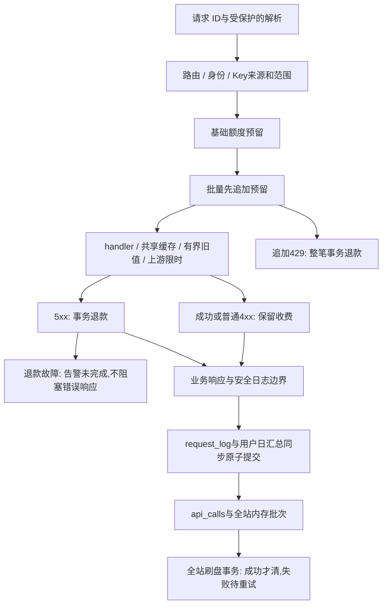

# 可靠性修复与第二轮流程复查

## 绑定与范围

本轮起点为 `Miao-API` 的文档检查点 `296196f44965cb478399b0d302ab9bd9dc9e3476`，应用基线为 `a1ba2614de424835bab2a05b808a33b9a21de648`。修复前已在忽略目录保存完整 Git bundle 并 verify；旧交付包保持不动。最终提交、源码哈希、测试日志和恢复包校验以 `data/onboarding/round2/` 的交付记录为准。

保留 Node22.13+、内置 SQLite、零依赖 ESM、原生前端、原有样式和路由声明。不修改默认分支、工作流、凭据、网络设置，不推送/PR/托管CI/发布。不读取真实用户库，不运行真实上游/付费/设备操作；故障注入、数据库及浏览器账号均为合成数据。

## 已修复及验证

| 原报告问题 | 最小实现 | 已验证 |
|---|---|---|
| 全站统计刷盘失败丢批次 | `stats.flushStats` 事务提交成功后清空 pending；BEGIN或写入失败保留批次，后续请求合并后重试；失败BEGIN不回滚别人的事务 | 多维计数/429写入故障、事务回滚、新调用合并、重复flush不重计、BEGIN失败、提交后跨进程重启 |
| 批量追加429残留入口扣款 | `limits.reserveAdditional` 追加额度被429拒绝时退整笔预留；`refund` 将基础/bonus多笔更新置于单一事务，成功后清charges；错误响应remaining反映退款后的基础额度 | 日额度、bonus不足、模块分钟429；确认业务工作未开展；基础/bonus混合成功、普通4xx继续收费、5xx退款、退款故障整体回滚/保留charges/重试幂等、跨午夜退到原扣款日 |
| Cookie/URL解析逃出HTTP边界 | 入口解析移入try，不合法返回400；未识别身份不计用户调用 | 畸形Cookie与URL、错误码BAD_REQUEST、随后health成功、handle无逃逸 |
| 页面/缓存请求归属不清 | 导航AbortController+navToken；用户列表局部ticket/isConnected；详情关闭与换日取消独享读请求；缓存写入版本检查；身份刷新不随导航取消且校验版本；router创建空的新main重建监听 | 25用户分页/size/搜索、23接口、慢搜索旧响应、跨页旧失败、同页刷新后详情按钮、旧预取在mutation后不回填、旧身份响应不覆盖新版本、导航不误清身份、详情乱序/关闭/换用户/重试、390px截图 |
| 无限旧值兜底与清除/取消语义 | TTLCache默认允许过期后最多6小时兜底；构造/调用参数maxStaleMs可显式覆盖，包括Infinity。delete使在途pending失效，旧loader不得回填或删除新pending；首次在途key立即登记模块；signal仅取消当前等待者 | 超龄拒绝、显式长期兼容策略、在途清除/新旧loader交错、模块首次在途清除、共享loader一人取消另一人成功、已取消不启动loader |

额外的小结构调整：北京时间 `today` 移到纯 `lib/day.js`，limits继续重导出以兼容原调用；stats不再与limits循环导入。默认时间从Date.now构造，便于确定性日界线测试。api_calls和全站统计的首次建表+回填均包入事务，避免失败留下“表已存在”的假完成状态；故障注入验证下次启动可重建回填，重启不重复。既有 user_calls 迁移事务、用户ID高水位、SQLite日志/用户日汇总触发器未删除或弱化。

## 独立复查与本轮查漏

独立代理只读复查没有修改代码、访问真实服务或凭据。它发现的三项遗漏均已落实，而不是只记录建议：

1. **预取遗漏版本检查：** 挂起的旧预取可能回填已清空缓存。修复为单请求+整批预取版本保护；身份变化同步失效旧批次。
2. **正文阶段取消误报502：** 响应头后的JSON读取异常原本一律转成“非法JSON”。HTTP包装现在保留调用方取消原因，正文超时转504；非法JSON仍502。text正文同样覆盖，全部用mock fetch验证。
3. **退款故障逃出handle：** 退款SQL故障在HTTP catch里再次抛错。两条HTTP退款路径现使用安全边界，事务失败记录含requestId的“退款未完成”，不清charges、不假称已退费。真实合成HTTP throw503/raw503两条故障路径均返回原业务错误，服务继续响应。

本轮浏览器也验证了空main重建的必要性：不会沿用克隆但已丢失事件监听的旧页面。最终独立复查未发现新的具体可复现缺陷；这不代表覆盖了生产规模、所有第三方协议或任意数据库灾难。

## 修复后的核心流程和责任

- HTTP入口负责请求解析、访问策略、预留/执行顺序、响应和观测故障隔离；业务handler仍负责参数和数据源。批量必须在开展外部工作前调用ctx.charge，目前生产调用点仅在batch模块的准备阶段。
- `limits` 负责额度及事务退款；分钟频率不退。追加预留不足整笔退款，仅作用于专门追加预留路径，不把任意业务429/4xx自动退款。
- `cache` 负责共享loader、TTL、6小时回退界限和失效；`http` 负责传输及正文超时/取消分类。取消等待者不等于强停共享上游。
- `logRequest` 与 user_calls触发器继续按完成写日志时的北京时间日记录HTTP次数；额度按扣款日记录，可跨午夜不同。api_calls/全站统计不与用户原子链路混称同一事务。
- 前端导航拥有导航读请求，列表拥有ticket，详情弹窗拥有独享controller；预取与身份是共享状态，通过版本隔离而不是误随导航终止。
- 启动时schema迁移、标记和高水位持久保存；清理原日志不删除用户日汇总。退出刷盘尽力执行，不能据环境快照假定内存状态可恢复。

## 未实施的大协议与保留风险

这些项目不能用一次局部修补假称解决；未绕过它们的限制：

- **SIGKILL/掉电前全站内存批次的强耐久：** 当前修复恢复可重试数据库故障，但进程被强杀仍会丢尚未刷盘的全站统计；跨进程合成测试明确区分提交/未提交。持久outbox需要确定事件ID、去重、水位、保留期和成本，未盲目引入。用户日汇总原子持久链路不受这一内存批次限制。
- **基础设施持续故障时的自动退费补偿：** 退款全部回滚、不会部分退，也不会杀HTTP入口，但持续失败时不会凭空变为成功。跨重启补偿账本涉及事件身份和幂等协议；本轮保留告警及原账目，不自动重放不明扣款。应按requestId核对后另行设计持久补偿。
- **已经存在的旧残缺表/已删除历史：** 本轮阻止新的首次回填半完成；无法识别旧版已经留下的残缺汇总与正常数据，更不能从已删日志补齐。不能无条件重建永久汇总而重复计数或覆盖历史。
- **全面的强制取消/自动回滚协议：** 巡检停止仍是“停止排队”，超时Promise.race不代表底层所有handler已停止；客户端断连未统一强停业务。共享loader和写操作强停有副作用，需要逐类约定。当前只修可安全确认的等待者取消和传输包装。
- **容量风险：** SQLite同步首次回填、长故障时待刷批次增长、调度任务重叠，尚无生产容量/延迟证据；不冒充已测性能问题或宣称吞吐提升。旧代码回滚/手工写users可能绕开新注册高水位契约，也应纳入后续升级兼容方案，未修改默认分支或更新发布机制。

## 第二轮有收益的优化顺序

1. 给统计待刷规模/失败时长、退款未完成、缓存回退年龄加可观察指标，再用合成规模测量决定是否需要持久outbox；不要立即替换SQLite或拆服务。
2. 小步提取用户管理前端功能模块，沿用本轮owner/ticket/controller规则，避免迁移到大框架；将页面级与共享状态清晰区分。
3. 后续升级使用显式迁移版本表，先接入新迁移，不将“表存在”当成所有历史迁移证据；保留事务与高水位契约。
4. 按数据源确认maxStaleMs允许值。默认6小时是本轮明确的兼容策略变化，长期历史接口可以显式Infinity，时效敏感接口可以0；不恢复无限兜底作为隐式全局规则。
5. 若确有巡检/抓取取消需求，再为受控handler逐步接入signal；先测不可取消副作用和共享加载，避免将“已停止UI”冒充“外部动作已停止”。

## 验证与交付

最终本地全套：**1143项通过，0失败、0取消、0跳过**；没有把未执行的真实上游测试算作通过。新增定向用例覆盖退款与统计故障注入、首次回填重启、未刷批次重启边界、额度/bonus/分钟失败、取消/正文超时/缓存和页面乱序。最终浏览器、语法、源码哈希与恢复验证结果以交付记录为准；此前1143全套后未改产品源码，文档与辅助浏览器脚本不改变产品行为。

配置草稿保持原样。现有push/PR会触发仓库Actions测试，本轮不推送也不改工作流；仓库外自动部署未调查，不据此获得任何推送/发布授权。其他项目不在本轮仓库范围内。
