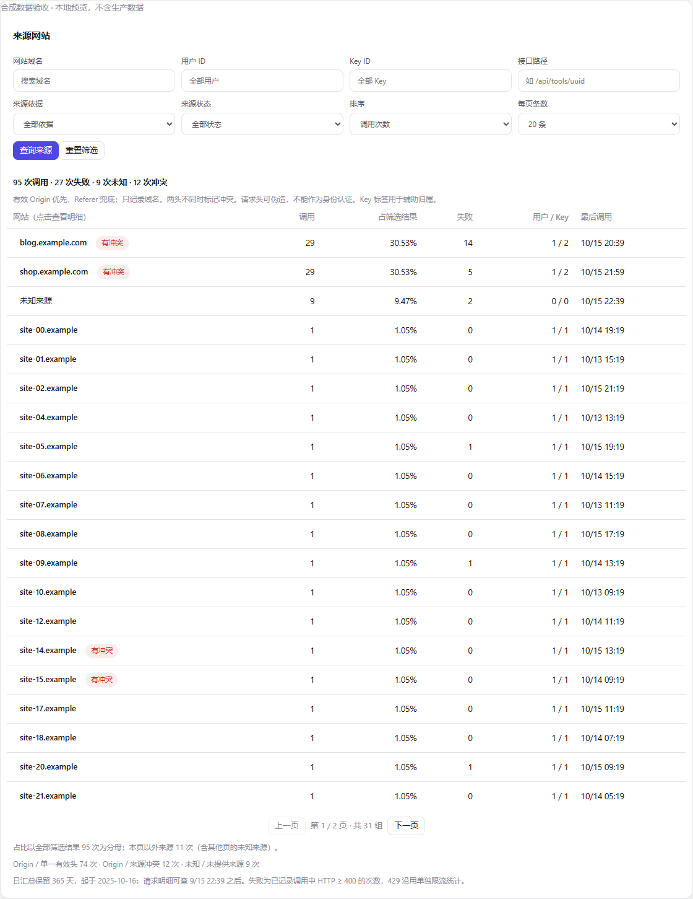
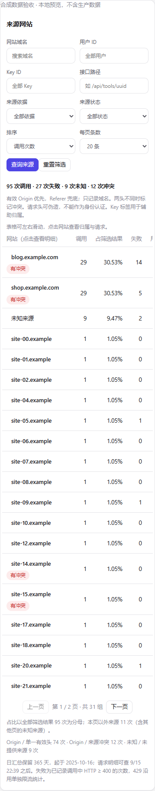
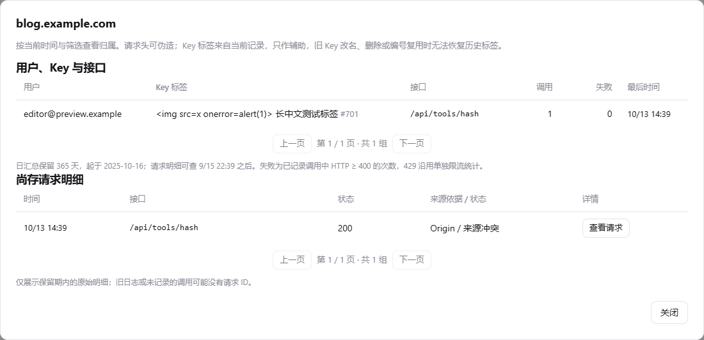
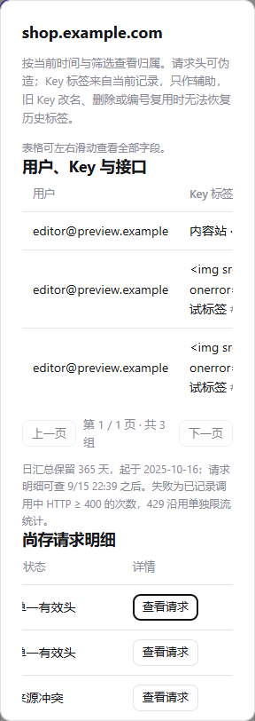

# 来源追踪验收记录

2026-10-15，在独立工作区 `D:\codex存储\2026-10-15\task-4\api` 完成。读取基线与同步前远端均为 `76b1c618fb003a76e5a169c2dd42e15df90c75d3`，分支为 `Miao-API`。运行环境为 Windows、Node `v24.19.0`，应用最低要求继续保持 Node 22.13。

## 实际执行

| 命令 / 检查 | 结果 |
| --- | --- |
| `git clone --branch Miao-API --single-branch https://github.com/bocmiao/api.git api` | 初次受限环境 DNS 失败；正常网络审批后成功 |
| `git rev-parse HEAD` | 与上述基线一致 |
| 读取仓库树、`.github/workflows/ci.yml`、项目代码与测试 | 未发现 AGENTS/CONTEXT/ADR；工作流仅 `workflow_dispatch`，无 CNB 配置，未修改流程 |
| `node --test test/analytics.test.js test/user-calls.test.js` | 初次受限环境拒绝本机回环 HTTP；正常审批并建立现有测试所需临时目录后，14/14 通过 |
| `node --test test/source.test.js` | 首轮暴露测试自己的毫秒边界假设，修正测试到半开区间后通过；最终该文件7项用例随全套通过 |
| `node --test` | 首跑1175通过、2失败，均为 Windows `autocrlf` 影响更新包字节核验；设置本任务克隆 `git config core.autocrlf false` 并核对换行后全过 |
| `node --test`（最终，含新增回滚与日界线测试） | **1179 通过、0 失败、0 跳过**，112 suites；原始日志保存在忽略目录 `data/source-tests-final.txt` |
| `node --check public/admin-stats.js`、`git diff --check` | 通过 |
| `git push --dry-run origin HEAD:Miao-API` | 返回 `Everything up-to-date`，未写远端；本地旧 credential-manager 路径输出一次不存在警告，未修改凭据或绕过权限拒绝 |
| `node scripts/check-source-ui.js`（已安装 Playwright + 真实 Chromium） | Chromium **153.0.8010.12**，10组检查通过，JavaScript page errors 为0 |

浏览器实际使用环境变量 `PLAYWRIGHT_MODULE=file:///C:/Users/10743/.cache/codex-runtimes/codex-primary-runtime/dependencies/node/node_modules/playwright/index.mjs` 与 `CHROMIUM_PATH=C:\Users\10743\AppData\Local\ms-playwright\chromium-1243\chrome-win64\chrome.exe`，通过正常执行审批运行。原 UI 连接器因 Windows platform directory 不存在无法启动，因此采用上述本地真实 Chromium。未安装新依赖，未调用线上接口、部署、巡检、预热、购买或更改凭证/权限设置。

## 覆盖结果

新增后端用例覆盖缺失/null、多值、非法协议、凭证、控制字符、畸形与伪造头、冲突、IDNA/Unicode、100字符以上合法域名及非法超长标签；Key 域名通配符与 Referer 兜底兼容；来源隐私字段；重复迁移、安装失败完整回滚与重试、插入事务回滚、清理后汇总持久保留；完整分母和其他来源、稳定分页、LIKE 转义、组合过滤、参数拒绝、401/403及 no-store；北京时间日界线、半开区间、整日/首尾明细合并去重和过期边界覆盖说明。

浏览器覆盖桌面分页、网站+用户+Key+接口+状态组合筛选、恶意 Key 标签作为纯文本显示、请求详情来源依据、无结果、模拟503与重试、390px和320px无页面横向溢出、键盘提交、窄屏弹窗、焦点循环/返回和 Escape、浏览器401/403。表格在窄屏内横向滚动，页面本身不横向溢出。使用 reduced motion，截图均为内存合成数据；区域截图隐藏固定顶栏以免长截图拼接遮挡。

[机器可读浏览器结果](source-tracking-browser.json)

| 桌面来源筛选 | 手机来源筛选 |
| --- | --- |
|  |  |

| 用户与 Key 归属 | 手机归属弹窗 |
| --- | --- |
|  |  |

## 适用限制

这是本地实现与合成数据验收，没有连接或迁移生产数据库。上线启动时才会对实际数据库执行事务迁移；迁移前已删除的历史、原始头和旧 Key 历史标签无法恢复，界面会说明覆盖不足。429 延续原有单独限流计数，不能按网站追溯。仓库未增加依赖、生成 API Key、改变既有权限规则或修改 CI/CNB 配置。
